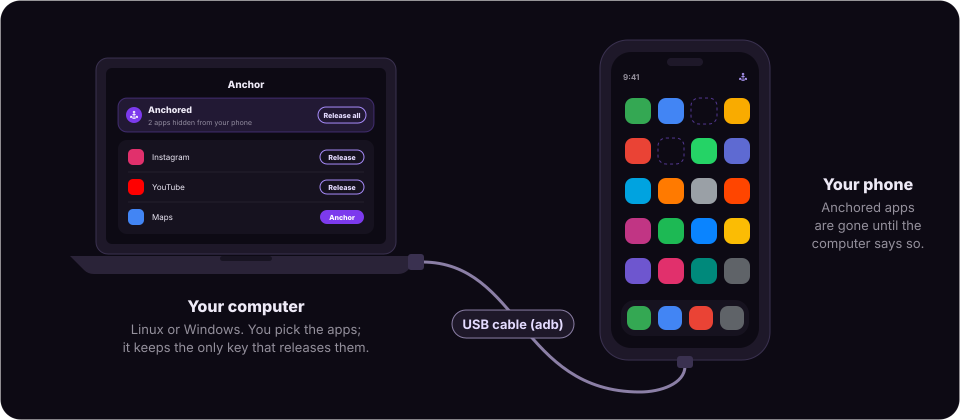

# Anchor

[](https://www.python.org/)
[](LICENSE)

<p align="center">
  <br>
  
</p>

Anchor is an app blocker for Android that helps you spend less time on your phone and is impossible to bypass from the phone itself, giving you an extra layer of friction that should be more than enough to break the habit. You choose the distracting apps on your computer, and with a few clicks they disappear from your phone. Only that same computer (or another computer with your backup key) can release them back.

Most conventional app blockers stop working the moment you really want to open an app, because undoing them is usually quite easy. With Anchor, the only way to bring them back is to plug your phone into your computer, and that small extra step is often enough to do the trick.

Each app can also have its own **schedule**, for example YouTube hidden every night from 22:30 to 07:00, or Instagram during work hours. The phone follows it on its own, even when it isn't connected. The **Never allow** list keeps certain selected apps from being installed at all. By default, it starts with the major social media apps (TikTok, Instagram, Threads, Facebook, Reddit, YouTube, Snapchat, X, Pinterest, Tumblr); Messenger and WhatsApp aren't on it.

> **This is the free version, and it is locked to one phone.** Each computer works with a single phone. See [Free version](#free-version).

## Contents

+ [How it works](#how-it-works)
+ [Free version](#free-version)
+ [Requirements](#requirements)
+ [Installation](#installation)
+ [Setting up the phone](#setting-up-the-phone)
+ [How to use](#how-to-use)
  - [Anchoring apps](#anchoring-apps)
  - [Never allow](#never-allow)
  - [Schedules](#schedules)
  - [App details and permissions](#app-details-and-permissions)
  - [Backup key](#backup-key)
  - [Removing Anchor from the phone](#removing-anchor-from-the-phone)
  - [Removing Anchor from the computer](#removing-anchor-from-the-computer)
+ [Troubleshooting](#troubleshooting)
+ [Privacy](#privacy)
+ [Contribution](#contribution)
+ [Donations](#donations)
+ [License](#license)

## How it works

The desktop app talks to your phone over the USB data cable. During setup it installs a small companion app (about 25 KB) on the phone named Anchor and makes it the phone's **device owner**, the same mechanism companies use to manage work phones. What makes the block stick is the fact that the companion app can't be turned off or uninstalled from the phone since it's now the device owner.

When you anchor an app, the companion app:

- hides it from the home screen and the app drawer (on Android 16 and newer it may still be listed in Settings → Apps, but it can't be opened)
- suspends it, so it can't run or show notifications
- revokes its permissions (camera, microphone, location, contacts, photos, notifications, etc.) and locks them; they're restored exactly as they were when the app is released
- blocks uninstalling it, so you can't delete it and reinstall it from the Play Store
- blocks adding new users or guests, so you can't install it in another profile

Nothing gets deleted. Data, logins and settings in those apps stay where they are.

<p align="center">
  
</p>


## Free version

This free version of Anchor is locked to **one phone per computer**. The first phone set up on a computer is the one it keeps, and setting up a second phone is refused.

- **Switching to a different phone:** connect the current phone and use **Menu → Remove Anchor from phone**. Every hidden app comes back and the computer is free to set up another phone.
- **A phone that was factory reset, lost or replaced:** when setting up the new phone, choose **Forget** in the dialog. The computer then gets a new backup key, so the old phone can no longer be controlled from it. If the old phone still had anchored apps, they stay hidden until it is factory reset.
- **More than one phone:** a paid Pro version with no limit on phones and a lot more features may follow if there’s enough interest. Let me know if you’d use it.

## Requirements

**Computer**

- **Linux:** GTK 4 and libadwaita 1.5 or newer (e.g. Ubuntu 24.04+, Fedora 40+, Arch), and Python 3.10+
- **Windows:** Windows 10 or 11 (64-bit)
- A USB cable that carries data, not just charge

**Phone**

- Android 10 or newer
- USB debugging enabled

## Installation

### Linux

Debian-based (**Debian, Ubuntu, Debian, Linux Mint, Pop!_OS, etc**): download [anchor-linux.deb](https://github.com/medpaf/anchor/releases/download/linux/anchor-linux.deb), then install it (this also installs adb and everything else Anchor needs):

```
sudo apt install ./anchor-linux.deb
```

**Any other Linux:** download [anchor-linux.tar.gz](https://github.com/medpaf/anchor/releases/download/linux/anchor-linux.tar.gz), unpack it and run its installer:

```
tar -xzf anchor-linux.tar.gz
cd anchor-linux
./install.sh
```

**From this repository:** `cd free/linux` and run `./install.sh`.

Then open **Anchor** from the app grid, or run `anchor`.

### Windows

Download [anchor-win.exe](https://github.com/medpaf/anchor/releases/download/windows/anchor-win.exe) and run it. Then open **Anchor** from the Start menu.

GitHub builds these downloads by itself on every change, so the links always give the newest version.

### Updating

Open Anchor and choose **Menu → Check for updates…**. If you installed the `.deb`, **Update** downloads the new version, installs it after your password and restarts Anchor. Otherwise it opens the download page: install the new version over the old one, without uninstalling first. Either way, your backup key and settings stay.

To uninstall later, see [Removing Anchor from the computer](#removing-anchor-from-the-computer).

## Setting up the phone

**1. Enable USB debugging.** Go to Settings → About phone and tap Build number 7 times, then turn on USB debugging in Settings → System → Developer options. On Xiaomi, Redmi and POCO phones also turn on "Install via USB" and "USB debugging (Security settings)".

**2. Remove all accounts** in Settings → Passwords & accounts (Google, etc.). Your data stays on the phone and in the cloud. Also remove any guest user, work profile, Second space or Dual apps.

**3. Connect and set up.** Plug the phone in and open Anchor. Accept the "Allow USB debugging?" prompt on the phone and tick "Always allow from this computer". Click **Set up phone** — this installs the companion app, makes it device owner and pairs it with the computer.

**4. Sign back into your accounts** on the phone. Setup is done.

Android only lets you set a device owner on a phone without accounts so, because of that, during the initial setup, you need remove them for a few moments and add them back right after.

There's a helper in the desktop itself that will guide you through these simple steps.


## How to use

### Anchoring apps

Plug in the phone and open Anchor. Find an app under "Your apps" (there's a search box) and click **Anchor** — it disappears from the phone right away and moves to "Anchored apps". **Release** brings back one app; **Release all**, brings back everything.

Apps on your **Never allow** list show up in the phone's settings as "Blocked by Anchor": these are
Anchor's tiny placeholders that stop them from being installed.

Anchored apps disappear from the home screen and the app drawer. On Android 16 and newer, Settings → Apps may still list them, but they can't be opened, uninstalled or brought back from there. Older Android versions usually hide them from Settings too.

You can unplug the phone whenever you want — everything stays blocked. The phone app can never release anything.


### Never allow

The Never allow card is under the status bar. To add an app, click "Add an app…" and pick a suggestion or paste a Play Store link or package name. To remove one, click **Release** next to it; if it was hidden, it comes back.

An app on this list cannot be installed on the phone: trying to install it from the Play Store (or anywhere else) is refused.


### Schedules

Click the clock button on an app's row, then "Add a time". Choose the days and the start and end times. If the end is earlier than the start, the window runs past midnight; if they're the same, it lasts all day. An app can have several windows. Click one to edit it, use its switch to turn it off temporarily, or the bin icon to delete it.

Apps with a schedule show a coloured clock icon, and while a window is active the row says something like "Hidden by its schedule until 07:00". A scheduled app is hidden during its windows whether or not you've anchored anything. To end one early, tap the clock icon and remove the schedule or untoggle it.


### App details and permissions

Click an app's row to open its details: version, install and update dates, whether it's a system app, and its permissions, each with a switch. The switches change the permission on the phone right away, but they're greyed out while the app is anchored or on its schedule.


Apps that didn't come with the phone have an **Uninstall** button. If the app is on the Never allow list, it can't be installed again afterwards.

**Note:** Android doesn't allow hiding a few core apps (Phone, the default SMS app, the launcher, Settings). Anchor marks them "Can't be hidden".

### Backup key

The key that releases the apps can be found in **Menu → Backup key…**.

That key is also stored in `~/.local/share/anchor/key.json` on Linux and `%APPDATA%\Anchor\key.json` on Windows. It should be copied somewhere deliberately out of easy reach — a password manager, or a written note kept away from the phone.

On a new or reinstalled computer, install Anchor, connect the phone and enter the key with **Menu → Use a backup key…**.

**Note:** If you lose both the computer and the key, a factory reset is the only way to get the apps back.

### Removing Anchor from the phone

To safely remove Anchor from your phone, open the Desktop app, then **Menu → Remove Anchor from phone…** brings back every hidden app and makes the companion app give up device owner and uninstall itself. You can set it up again later.

### Removing Anchor from the computer

**Remove Anchor from the phone first** (see the section above). Uninstalling the desktop app deletes the key that releases your apps, and without it a phone that is still anchored can only be recovered with a factory reset.

To uninstall it:

- **Linux:** open the desktop app, then **Menu → Uninstall Anchor from this computer…**. It deletes your saved key, asks for your computer's password once and removes the app (the `anchor-linux.deb` package, or the files `install.sh` added).
- **Windows:** open **Settings → Apps → Installed apps**, find **Anchor** and choose **Uninstall**. Your saved key stays in `%APPDATA%\Anchor`, so a reinstall picks up where you left off; delete that folder too if you're done with Anchor for good.

## Troubleshooting

| Message | What to do |
|---|---|
| "Connect your phone" doesn't go away | Check that USB debugging is on and the cable carries data. Try a different port. On Windows, some phones also need their maker's USB driver (Google's USB driver for Pixel phones). |
| "Windows protected your PC" when installing | Windows shows this for new apps that aren't code-signed yet. Click **More info → Run anyway**. |
| "Allow this computer" | Unlock the phone and tap Allow. If there's no prompt, unplug and replug the cable. |
| "Remove the accounts from your phone first" | The message lists the accounts still signed in. Remove each one in Settings → Passwords & accounts. Some app accounts only disappear once you sign out inside the app or uninstall it. |
| "Remove extra users and work profiles" | Delete the guest user, work profile, Second space or Dual apps. |
| "The phone blocked the install" | Turn on "Install via USB" in Developer options and look for a confirmation prompt on the phone. |
| "One more developer switch is needed" | On Xiaomi phones, turn on "USB debugging (Security settings)". |
| "Another app already manages this phone" | It's a work or school phone. Anchor can't be used on it. |
| "The free version works with one phone" | This computer is already set up for another phone. Remove Anchor from that phone first, or forget it if it was reset or lost. See [Free version](#free-version). |
| "Anchored to another computer" | The phone was paired with a different computer. Enter that computer's backup key. |


## Privacy

Anchor doesn't collect any data from your phone or your computer, and it doesn't send anything
anywhere.

- **No internet access.** The phone app doesn't even have Android's internet permission, so it can't go
  online. The desktop app only talks to your phone, over the USB cable. The one exception is
  **Menu → Check for updates…**: only when you click it, it asks GitHub which build is the newest.
  Nothing about you, your phone or your apps is sent.
- **No accounts, no tracking, no analytics.** Nothing is uploaded, and nobody else can see which apps
  you anchor or block.
- **Everything stays on your devices.** Your app lists, schedules and settings are stored on the
  phone. The computer keeps only its keys.

## Contribution

Contributions are welcome. Open an issue or pull request, or get in touch at [pafmed@protonmail.com](mailto:pafmed@protonmail.com).

By contributing, you agree that your contribution is released under the GPL-3.0 license and may also be used in a paid version of Anchor, if that ends up happening.

## Donations

Similar apps to Anchor tend to be expensive, and that's for a single phone.

I didn't want Anchor to work like that. I'm an advocate for privacy and for people having full control of their own device, and I wouldn't feel good about locking all of that behind a paywall. So the free version stays free forever.

That said, building it for both Linux and Windows took a lot of work. If it's useful to you and you get good use out of it, [buying me a coffee](https://github.com/sponsors/medpaf) helps support its development. Either way, thanks for using it!

## License

Anchor is free software, released under the [GNU General Public License v3.0](LICENSE). You can use, study, change and share it; if you share a changed version, it has to be under the same license, with its source code.

Copyright © 2026 Paulo Medeiros.
