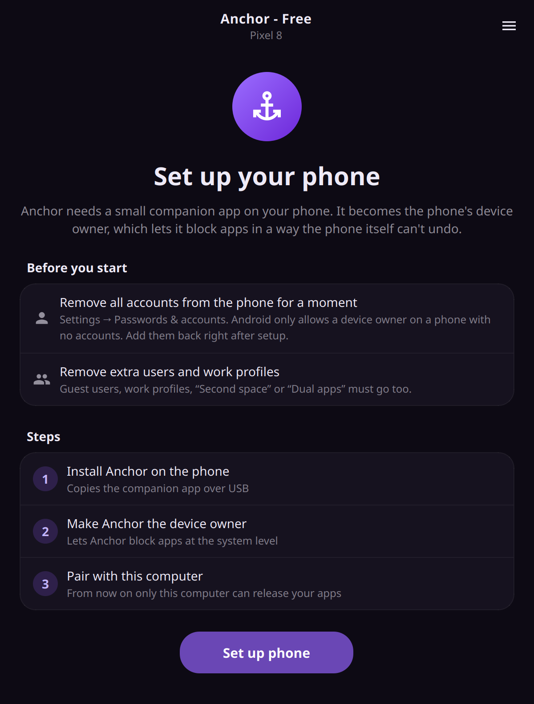
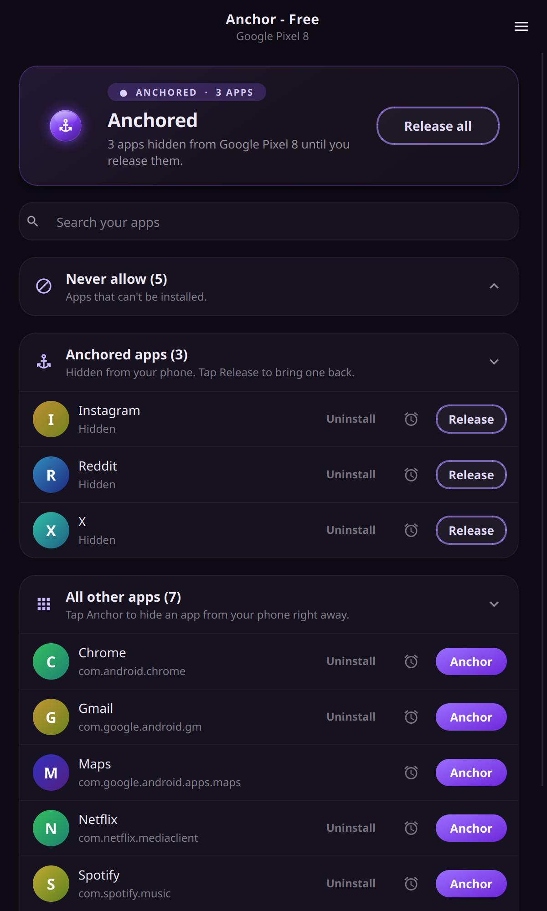
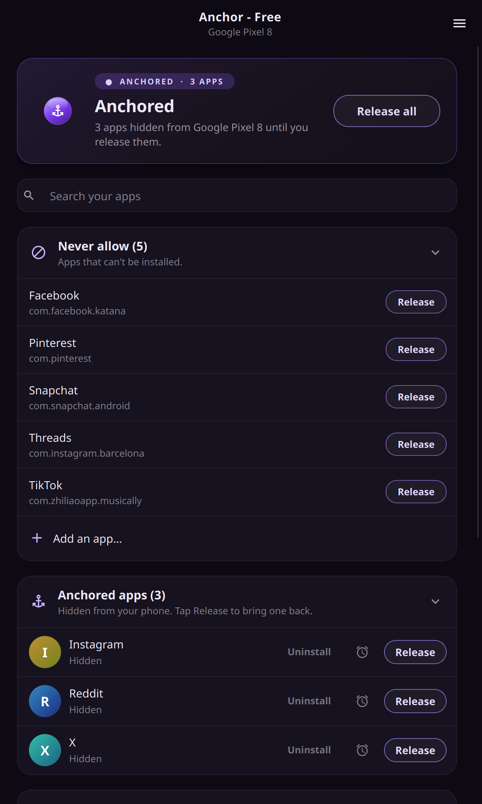
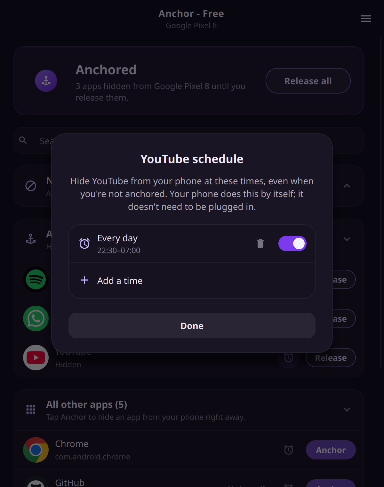
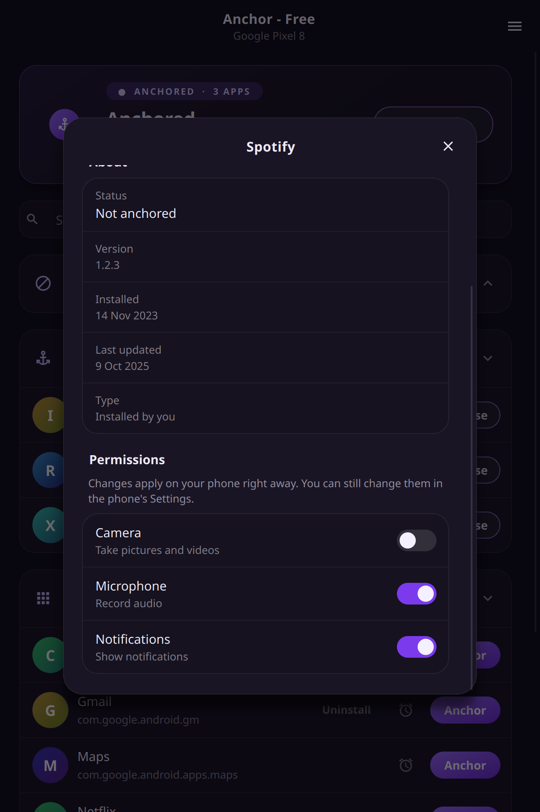

# Anchor

[](https://www.python.org/)
[](LICENSE)

<p align="center">
  <br>
  
</p>

Anchor is an app blocker for Android that you can't turn off from the phone. You pick the apps that distract you on your computer, and they disappear from your phone. To get them back, you have to plug the phone into that same computer (or another one with your backup key).

I made it because every app blocker I tried had the same problem: the moment I really wanted to open Instagram, turning the blocker off took two taps. With Anchor that's not an option, and having to go to the computer and plug in a cable is usually enough to make me stop and think.

You can also give an app a schedule, like YouTube hidden every night from 22:30 to 07:00, or Instagram during work hours. The phone takes care of that by itself, even when it's not plugged in. And there's a Never allow list for apps you don't want installed at all. It starts with the big social media apps (TikTok, Instagram, Threads, Facebook, Reddit, YouTube, Snapchat, X, Pinterest, Tumblr). Messenger and WhatsApp aren't on it.

> It works with one phone per computer.

## Contents

+ [How it works](#how-it-works)
+ [Requirements](#requirements)
+ [Installation](#installation)
+ [Setting up the phone](#setting-up-the-phone)
+ [How to use](#how-to-use)
  - [Anchoring apps](#anchoring-apps)
  - [Never allow](#never-allow)
  - [Schedules](#schedules)
  - [App details and permissions](#app-details-and-permissions)
  - [Backup key](#backup-key)
  - [Removing Anchor from the phone](#removing-anchor-from-the-phone)
  - [Removing Anchor from the computer](#removing-anchor-from-the-computer)
+ [Privacy](#privacy)
+ [Contribution](#contribution)
+ [Donations](#donations)
+ [License](#license)

## How it works

The desktop app talks to the phone over USB. During setup it puts a small companion app on the phone (about 25 KB, also called Anchor) and makes it the phone's device owner. That's the same thing companies use to manage work phones, and it's what makes the block stick: a device owner app can't be switched off or uninstalled from the phone.

When you anchor an app, the companion app hides it from the home screen and the app drawer, and suspends it so it can't run or send notifications. It also takes away its permissions (camera, microphone, location and so on) until you release it, and puts them back exactly how they were afterwards. It stops the app from being uninstalled, so you can't just delete it and reinstall it, and it stops new users or guests from being added so you can't install it in another profile either.

Nothing gets deleted. The app's data and logins are still there when you release it.

Anchored apps can still show up on your phone in Settings → Apps, but they can't be opened from there.

It only works with one phone per computer. Whichever phone you set up first is the one it keeps.

If you want to switch phones, connect the current one and use Menu → Remove Anchor from phone. Everything comes back and you can set up the new phone.

If your old phone was reset, lost or replaced, choose Forget when you set up the new one. Your computer gets a new backup key, so it can't control the old phone anymore. If the old phone still had apps anchored, they stay hidden until it's factory reset.

## Requirements

On the computer you need Windows 10 or 11 (64-bit), or Linux with GTK 4, libadwaita 1.5 or newer and Python 3.10 (Ubuntu 24.04, Fedora 40, Arch or anything newer works). You also need a USB cable that carries data, not just power.

The phone needs Android 10 or newer, with USB debugging turned on.

## Installation

### Linux

On Debian-based distros like Ubuntu, Linux Mint, Pop!_OS and others, download [anchor-linux.deb](https://github.com/medpaf/anchor/releases/download/linux/anchor-linux.deb) and install it. That also installs adb and everything else Anchor needs.

```
sudo apt install ./anchor-linux.deb
```

On any other Linux, download [anchor-linux.tar.gz](https://github.com/medpaf/anchor/releases/download/linux/anchor-linux.tar.gz), unpack it and run the installer:

```
tar -xzf anchor-linux.tar.gz
cd anchor-linux
./install.sh
```

If you've cloned this repository, you can also run `./install.sh` from `free/linux`.

Then open Anchor from your apps, or run `anchor` in the terminal.

### Windows

Download [anchor-win.exe](https://github.com/medpaf/anchor/releases/download/windows/anchor-win.exe), run it, and open Anchor from the Start menu.

### Updating

Go to Menu → Check for updates… and click Update.

Your backup key and settings are kept.

To uninstall, see [Removing Anchor from the computer](#removing-anchor-from-the-computer).

## Setting up the phone

1. Turn on USB debugging. Go to Settings → About phone and tap Build number 7 times, then go to Settings → System → Developer options and turn on USB debugging. On Xiaomi, Redmi and POCO phones, also turn on "Install via USB" and "USB debugging (Security settings)".
2. Sign out of all accounts in Settings → Passwords & accounts (Google included). Android only lets you set a device owner on a phone with no accounts. Your data stays where it is, and you sign back in right after. Remove any guest user, work profile, Second space or Dual apps too.
3. Plug the phone in and open Anchor. Tap Allow on the "Allow USB debugging?" prompt on the phone and tick "Always allow from this computer". Then click Set up phone.
4. Sign back into your accounts. That's it.

The desktop app walks you through all of this.



## How to use

### Anchoring apps

Plug in the phone and open Anchor. Find the app under Your apps (there's a search box) and click Anchor. It disappears from the phone straight away and moves to Anchored apps. Release brings one app back, and Release all brings everything back.

You can unplug the phone whenever you want and everything stays blocked. The phone itself can never release anything.

You can also anchor apps, add schedules and uninstall apps from the Anchor app on the phone. Releasing an app, or changing or removing a schedule, only works from the computer.



### Never allow

Apps on this list can't be installed on the phone, whether from the Play Store or anywhere else. Click "Add an app…" to add one, either from the suggestions or by pasting a Play Store link or a package name. Click Release next to an app to take it off the list.

In the phone's settings, these apps show up as "Blocked by Anchor". Those are tiny placeholder apps Anchor installs to stop the real ones from being installed.



### Schedules

Click the clock next to an app, then "Add a time", and pick the days and the start and end times. If the end is earlier than the start, it runs past midnight. If they're the same, it lasts all day. An app can have more than one. Click a time to edit it, use its switch to turn it off for a while, or the bin to delete it.

While a schedule is on, the app says something like "Hidden by its schedule until 07:00", even if nothing else is anchored. To end one early, open the clock and switch the schedule off or delete it.



### App details and permissions

Click an app to see its version, when it was installed and updated, and its permissions. Each permission has a switch that changes it on the phone right away. The switches are locked while the app is anchored or on its schedule.



Apps you installed yourself also have an Uninstall button. If the app is on your Never allow list, it can't be installed again afterwards.

Android doesn't let anyone hide a few core apps (Phone, the default SMS app, the launcher and Settings). Anchor marks those as "Can't be hidden".

### Backup key

The key that releases your apps is in Menu → Backup key…. It's also saved in `~/.local/share/anchor/key.json` on Linux and `%APPDATA%\Anchor\key.json` on Windows.

Save a copy right after setting up your phone, somewhere you can't get to on a whim, like a password manager or a note in a drawer. If you set up Anchor on a new or reinstalled computer, connect the phone and enter the key with Menu → Use a backup key….

If you lose both the computer and the key, the only way to get your apps back is a factory reset.

### Removing Anchor from the phone

Open the desktop app and go to Menu → Remove Anchor from phone…. Every hidden app comes back and the companion app removes itself. You can set it up again later.

### Removing Anchor from the computer

Remove Anchor from the phone first. Uninstalling the desktop app on Linux deletes the key, and without it a phone that still has apps anchored can only be fixed with a factory reset.

On Linux, open Anchor and go to Menu → Uninstall Anchor from this computer…. It deletes the key, asks for your password and removes the app.

On Windows, go to Settings → Apps → Installed apps, find Anchor and click Uninstall. The key stays in `%APPDATA%\Anchor`, so a reinstall picks up where you left off. Delete that folder too if you're done with Anchor for good.


## Privacy

Anchor doesn't collect anything and doesn't send anything anywhere. There are no accounts, no tracking and no analytics.

The phone app doesn't even have permission to use the internet. The desktop app only talks to your phone over the cable, except when you click Check for updates…, which asks GitHub which version is the newest. Nothing about you, your phone or your apps is sent.

Your lists and schedules are stored on the phone. The computer only keeps its key.

## Contribution

Contributions are welcome. Open an issue or a pull request, or email me at [pafmed@protonmail.com](mailto:pafmed@protonmail.com).

By contributing, you agree that I can use your contribution in Anchor under any license, including in a paid version, if that ends up happening.

## Donations

Building it for both Linux and Windows took a lot of work. If it's useful to you and you get good use out of it, [buying me a coffee](https://github.com/sponsors/medpaf) helps support its development. Either way, thanks for using it!

## License

Anchor is source-available under the [PolyForm Strict License 1.0.0](LICENSE). You can download it, use it for free for anything non-commercial and read the code, but you can't change it, share it or sell it. Download it from this page instead of passing copies around.

Copyright © 2026 Paulo Medeiros.
